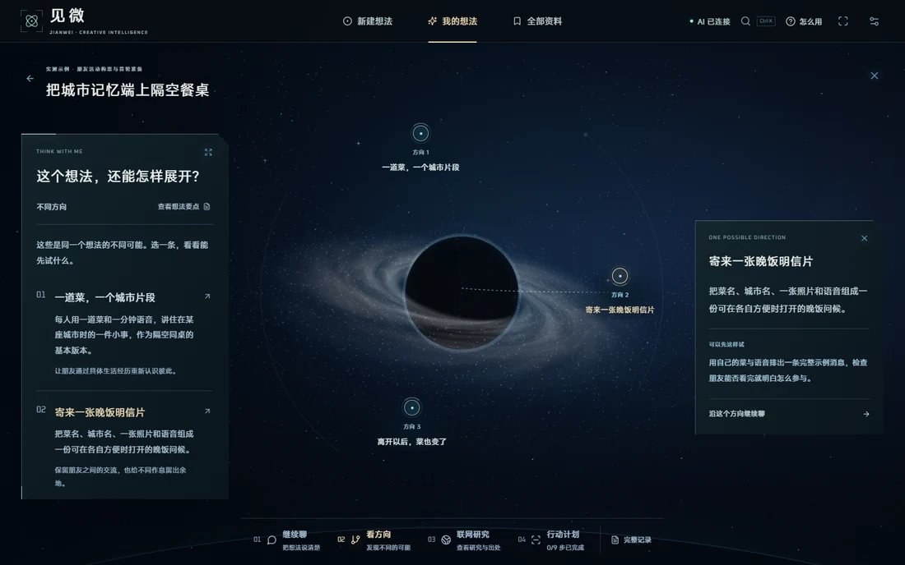
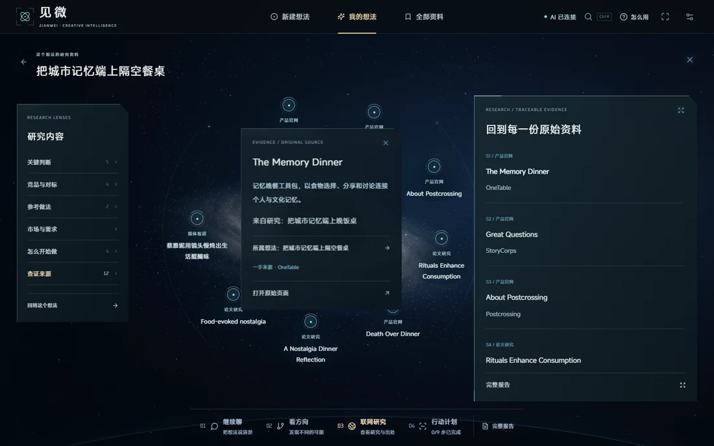
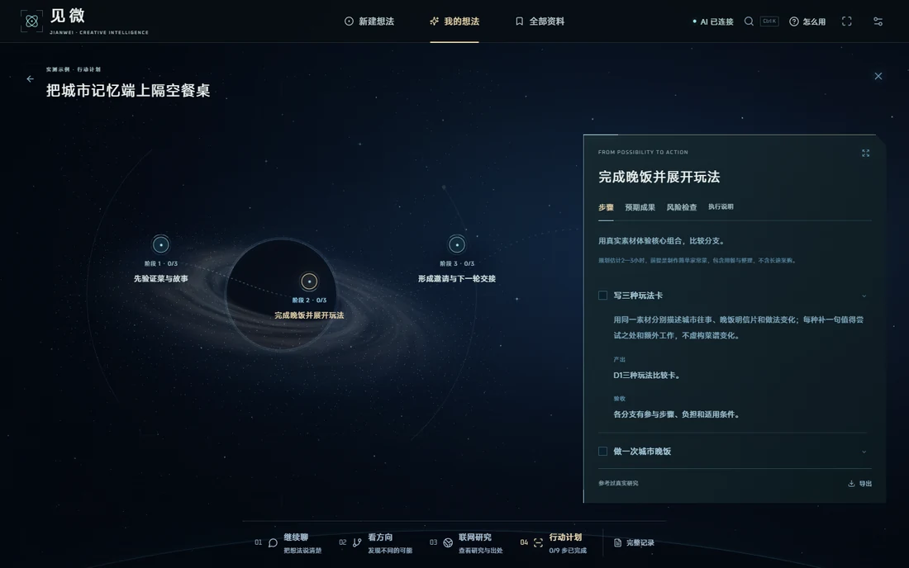
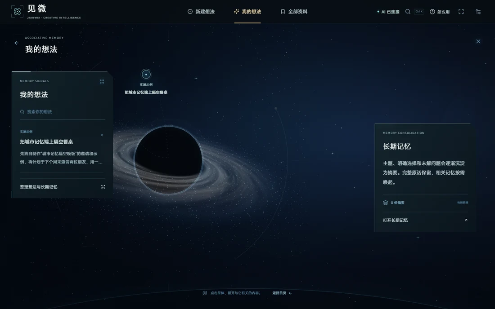

<div align="center">


### 把还没想清楚的话，展开成方向、依据和下一步。

本地运行的创意与研究助手。对话、联网研究、行动计划和长期记忆，围绕同一个想法展开。

[简体中文](README.md) · [English](README.en.md)

[](LICENSE)
[](https://nodejs.org/)
[](src/)
[](#数据与模型)

[**观看产品介绍**](https://github.com/XiaoWuheng/jianwei/releases/download/v3.0.0/jianwei-product-overview-zh-en.mp4) · [快速开始](#快速开始) · [如何使用](#从一句话到一个小尝试) · [参与开发](#参与开发)

</div>


## 从一句话，到一个小尝试

> “我想让独居时的晚饭更有仪式感。也许能和朋友一起玩，但我还不知道怎么做。”

把这句话留下来，沿着感兴趣的方向继续聊。见微会整理你已经表达的内容、提出可探索的分支，再通过真实研究和任务拆分，把下一步写清楚。想法可以成为内容、体验、服务、研究，也可以成为产品。

| 继续聊 | 看方向 | 联网研究 | 行动计划 |
| :--- | :--- | :--- | :--- |
| 用自己的话补全目标和限制，回看原话与历史版本。 | 比较可能的做法、假设和适合先做的小实验。 | 查对标、案例、代码和公开资料，保留原始出处。 | 列出阶段、任务、成果和验收标准，导出执行说明。 |

<table>
<tr>
<td width="50%"><b>先展开可能</b><br/>点击具体方向，查看它的价值、假设与小实验。</td>
<td width="50%"><b>让依据可追溯</b><br/>从研究结论回到来源，区分证据、推断和待验证问题。</td>
</tr>
<tr>
<td width="50%"><b>给出能做的下一步</b><br/>逐项推进任务，把 Markdown 执行说明交给合作者。</td>
<td width="50%"><b>以后接着想</b><br/>回看、搜索、组合旧想法，按周期整理带出处的摘要。</td>
</tr>
</table>

*以上为实际运行的演示案例。全新安装的想法库为空。*

## 快速开始

准备 [Node.js 24+](https://nodejs.org/)、Git，以及已安装并登录的 [Codex CLI](https://github.com/openai/codex#quickstart)。先用 `codex login status` 确认账号可用。

```sh
git clone https://github.com/XiaoWuheng/jianwei.git
cd jianwei
npm ci
npm run build
npm start
```

打开 **[http://127.0.0.1:4317](http://127.0.0.1:4317)**，写下想法，点击「帮我想一想」。

Windows 完成构建后，也可双击 `打开见微.vbs`，使用 Chrome 或 Edge 全屏进入，按 F11 切换。Windows 引擎检测使用原生 `codex.exe`，可通过 Codex 官方独立安装程序安装。若引擎没有被找到，设置环境变量 `JIANWEI_CODEX_PATH` 指向可执行文件，再启动见微。

## 数据与模型

- 想法、原话、笔记、研究和任务进度保存在本机 `data/jianwei.sqlite`，支持完整 JSON 备份与导入。
- 推演、联网研究和摘要通过本机 Codex 配置对应的模型服务处理，需要网络与相应服务额度。相关输入和上下文会发给该服务。
- 检索围绕具体任务追踪中英文公开来源。报告说明实际覆盖，登录、付费和不可索引内容可能无法取得。
- 原话持续保留。摘要支持手动整理或在服务运行时按周期检查；可回溯出处、校准理解。
- 服务默认只监听 `127.0.0.1`。浏览器支持时可进行语音输入。

## 参与开发

```sh
npm run dev    # 本地开发
npm test       # 核心测试，无需模型服务
```

| 目录 | 内容 |
| :--- | :--- |
| `src/` | React / TypeScript 界面、空间交互与 Three.js 场景 |
| `server/` | 本地 HTTP 服务、Codex 调用、SQLite、推演与研究流程 |
| `scripts/` | Windows 启动和可选资源安装 |
| `tests/` | 核心数据、任务、记忆和来源验证 |

可设置 `JIANWEI_PORT`、`JIANWEI_DATA_DIR` 调整端口和数据目录。

欢迎提交 [Issue](https://github.com/XiaoWuheng/jianwei/issues) 或 PR。界面问题请附窗口尺寸和复现步骤，模型问题请说明使用的提供方及可公开的错误信息。提交前运行 `npm test` 与 `npm run build`。

## 许可证与致谢

原创代码采用 [MIT](LICENSE)。React、Three.js、Lucide 和字体按各自许可证使用，详见 [第三方声明](THIRD_PARTY_NOTICES.md)。

产品介绍配乐为 Scott Buckley 的 [《Discovery》](https://www.scottbuckley.com.au/library/discovery/)，采用 [CC BY 4.0](https://creativecommons.org/licenses/by/4.0/)，片中节选并与旁白混音。完整署名随视频提供。
